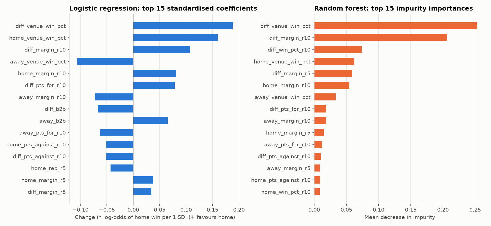
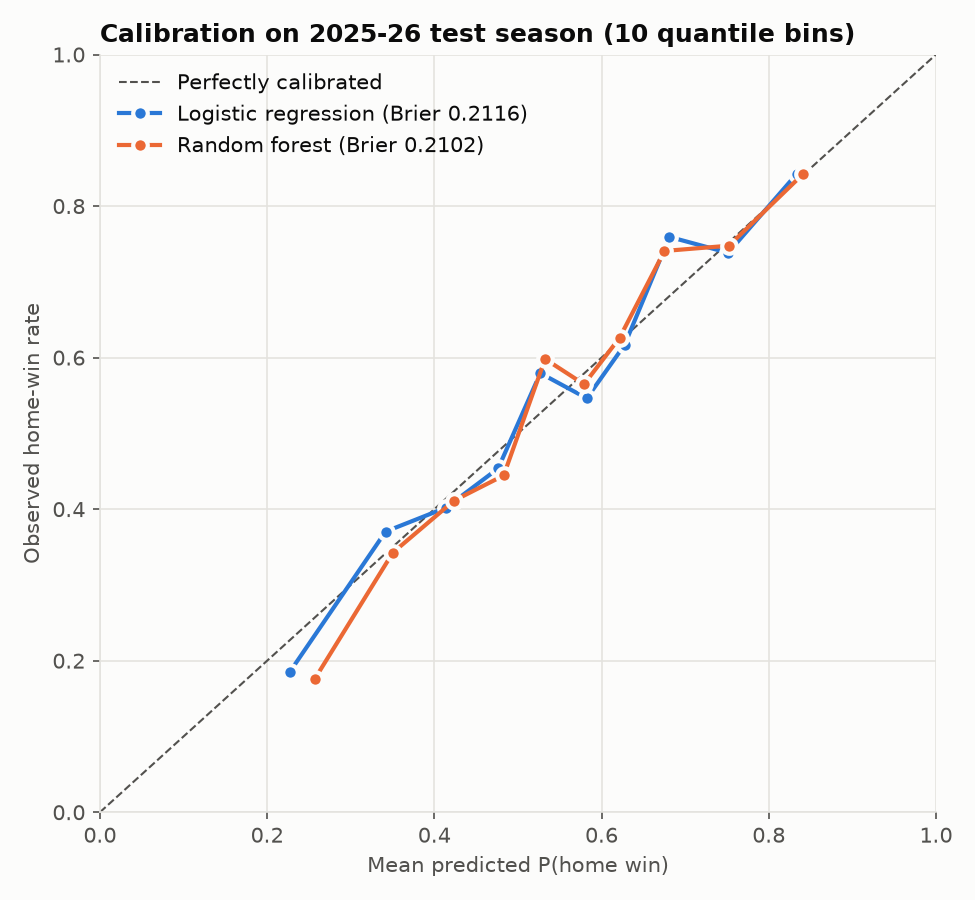

# NBA Home-Win Predictor

Predicting whether the home team wins an NBA regular-season game, using only information available
before tip-off.

All code, outputs and figures are in [`nba_home_win_predictor.ipynb`](nba_home_win_predictor.ipynb).

## Problem

Binary classification: for each game, estimate P(home team wins). The model may only use what was
known before the game started, i.e. results of each team's *earlier* games that season and its rest
schedule. Box-score stats from the game being predicted are never used.

## Data

**Source:** Eoin Moore, [*Historical NBA Data and Player Box Scores*](https://www.kaggle.com/datasets/eoinamoore/historical-nba-data-and-player-box-scores) (Kaggle):
* `Games.csv`: one row per game (teams, final score, winner, game type)
* `TeamStatistics.csv`: one row per team per game (rebounds, turnovers, quarter scores, ...)

**Scope:** regular-season and NBA Cup games, seasons 2015-16 to 2025-26 (13,208 games). Preseason,
All-Star, play-in and playoff games are excluded. Seasons are taken from the game ID, not the calendar,
so the July–August 2020 "bubble" games stay in 2019-20.

**Data issues found and handled** (details in the notebook):
* The first column header in `TeamStatistics.csv` is corrupted (`regulagameId`); renamed to `gameId`.
* Two 2024-25 games are recorded 0–0 in both files. Their scores were rebuilt from quarter-by-quarter
  points (quarter sums match the final score in 23,951 of 23,952 other rows) and checked against
  plus-minus. For one of them (22400627) the `winner` column contradicts the scores, plus-minus and both
  teams' running records, so the winner is recomputed from the scores.
* Two placeholder rows for postponed 2025-26 games (score 0, no stats) are dropped.
* Four 2024-25 games are missing from both files and can't be recovered.

## Features

45 pre-game features. Each per-team feature appears for the home team, the away team, and as
home − away:

| Group | Definition |
|---|---|
| Rolling form | Mean points scored, points allowed, point margin, rebounds, turnovers and win % over the team's previous **5** and **10** games |
| Rest | Days since the team's previous game (capped at 7); back-to-back flag |
| Venue form | Home team's win % in its home games this season; away team's win % in its away games this season |

**Leakage controls**
* Every window is shifted by one game, so a game's own result is never included.
* Windows are computed within (team, season) and never carry over from the previous season.
* Games where either team has played fewer than 10 games that season are dropped (1,713 games),
  leaving **11,495** modelling games.
* Team names and IDs are not features.
* A spot check recomputes features from scratch for 300 random team-games using only strictly earlier
  games; all match. The largest feature–outcome correlation is 0.308.

## Split and validation

* **Train:** 2015-16 to 2024-25 (10,419 games). **Test:** 2025-26 (1,076 games), held out and
  scored once.
* Hyperparameters tuned with `GridSearchCV` + `TimeSeriesSplit(n_splits=5)` on chronologically ordered
  training games (ROC AUC), so every validation fold comes after its training data.
* **Baseline:** always predict a home win.
* **Models:** logistic regression (StandardScaler + L2, tuned `C` → 0.003) and random forest
  (300 trees, tuned → `max_depth=6`, `min_samples_leaf=50`, `max_features=0.3`).
* **Uncertainty:** 95% bootstrap percentile intervals from 2,000 resamples of test games, with all models
  scored on the same resamples so paired differences get their own intervals.

## Results (2025-26 test season)

| Model | Test accuracy (95% CI) | Test ROC AUC (95% CI) | CV ROC AUC | Brier |
|---|---|---|---|---|
| Baseline (always home) | 54.9% (52.0–58.0%) | 0.500 | — | 0.2478* |
| Logistic regression | 66.7% (63.9–69.5%) | 0.720 (0.689–0.750) | 0.691 | 0.2116 |
| Random forest | 67.1% (64.3–69.9%) | 0.725 (0.695–0.756) | 0.687 | 0.2102 |

\*Brier score of a constant prediction equal to the training-set home-win rate.

* Both models beat the baseline by about 12 percentage points (LR +11.8, 95% CI 8.2–15.5; RF +12.2,
  95% CI 8.7–15.8).
* **The two models aren't distinguishable:** RF − LR accuracy is +0.4 pts (95% CI −1.0 to 1.9) and
  RF − LR AUC is +0.005 (95% CI −0.002 to 0.012).
* Test AUC (≈0.72) is above cross-validated AUC (≈0.69). The test season was never used for tuning, so this
  reads as 2025-26 being a somewhat easier season to call, not as leakage. The CV figure is the more
  conservative estimate.
* Train and test accuracy are close (LR 65.3% vs 66.7%, RF 67.5% vs 67.1%), so there's no meaningful
  overfitting. Both models are well calibrated (see `figures/calibration.png`).
* Home-court advantage itself shrank: the home team won 58–59% of games in 2015-16 to 2018-19 but only
  about 54–56% from 2019-20 onward.




## Which features mattered most, and why

Two feature groups dominate both models: **point margin** (36% of total random forest importance, led
by the 10-game home − away margin) and **venue-specific win %** (35%, led by the home − away
difference); together they account for about 71%. Margin works better than the rolling win % (10%)
because it measures team strength with less noise: a team that wins close games and loses blowouts
looks better by win % than it is, and margin sees through that. Venue win % is a season-to-date measure,
so by game 10 it rests on more games than a 5- or 10-game window, and it captures how teams play at
home or on the road specifically. Ten-game windows outrank five-game windows for the same reason
(more games, less noise). Rebounds and turnovers add little (about 4% each) because their effect on
winning already shows up in points scored and allowed. Rest has a small effect in the expected
direction: in the logistic model an away team on a back-to-back raises the home team's win odds
(`away_b2b` +0.065 and `diff_b2b` −0.067 both push toward a home win), and a home team on a back-to-back
lowers them. Because the `diff_` features are exact linear combinations of the home and away features
and many features are highly correlated, individual coefficients aren't causal effects. The group-level
ranking is the robust conclusion.

## Reproducing

```bash
python3 -m venv .venv
.venv/bin/pip install -r requirements.txt
# put Games.csv and TeamStatistics.csv in csv/
.venv/bin/jupyter nbconvert --to notebook --execute --inplace nba_home_win_predictor.ipynb
```

Results were produced with Python 3.14, pandas 3.1.0, scikit-learn 1.9.1 and matplotlib 3.11.2.
Random seeds are fixed (random forest `random_state=42`, bootstrap seed 42).
